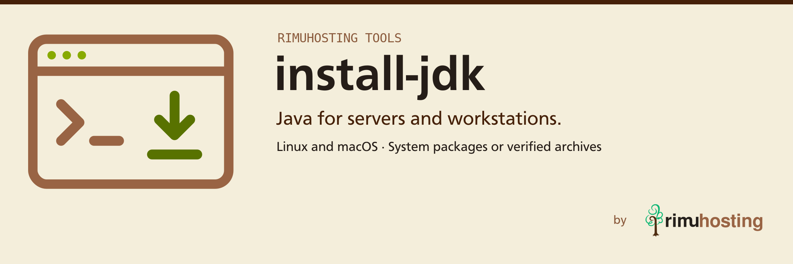

# install-jdk



Install the Java Development Kit (JDK) your application needs on Linux or macOS.
One Bash script installs Amazon Corretto through signed Linux packages or a
SHA-256-verified archive. It also supports Azul Zulu for Java 8 on 32-bit x86
Linux and OpenJDK early-access builds. Run it as an administrator to provision
a server or as your own user to set up a development environment.

## Get started

Download the script with either command.

```bash
curl --fail --location --output install-jdk.sh \
  https://raw.githubusercontent.com/pbkwee/install-jdk/main/install-jdk.sh
```

```bash
wget --output-document=install-jdk.sh \
  https://raw.githubusercontent.com/pbkwee/install-jdk/main/install-jdk.sh
```

Review the downloaded script, then preview the install. The examples use
JDK 21. Replace it with the Java major your application requires.

```bash
bash ./install-jdk.sh --jdk-version 21 --dry-run
```

The preview shows the install method and destination for the user running it.
For a system-wide preview, use the same `sudo` and options you intend to install with.
If you pipe the script to Bash, see [the stdin example](docs/usage.md#download-and-run).

### Provision a Linux server

When you need a system-wide JDK and package-manager updates, require package
mode. The installer adds or reuses the Corretto repository on supported
distributions and installs the selected major version.

```bash
sudo bash ./install-jdk.sh --jdk-version 21 --install-mode package
```

The distro's alternatives policy controls which Java runs by default. Add
`--activate alternatives` if you want this JDK to be the system choice for both
`java` and `javac`. For a service such as Tomcat, set `JAVA_HOME` in the
service's own configuration and restart it to pick up the new JDK.

### Set up a laptop or a personal account

On Linux or macOS, run as your own user. This installs the JDK under your home
directory and sets `JAVA_HOME` and `PATH` for new Bash or Zsh sessions.

```bash
bash ./install-jdk.sh --jdk-version 21 --activate user-profile
```

Open a new terminal or run `. "$HOME/.config/rimuhosting/java.sh"` in your
current shell. Check which Java you will use with `java -version` and
`javac -version`. If your IDE has a separate JDK setting, select the path that
the installer reports.

## Choose the right tool

| If you need… | Use… |
| --- | --- |
| One repeatable JDK setup across servers and personal accounts | **install-jdk**. Use `auto` to let it choose the install method, `package` to require a signed Corretto repository, or `archive` for a user install, custom location, or older Linux system with compatible libraries. |
| The JDK your Linux distribution already carries | **Your distro's package manager**. Use its OpenJDK package if it supplies the major you need and you want to stay with your existing repositories. |
| Java managed with your other Mac tools | **Homebrew**, if you already use it and it carries the version you need. [Example formula](https://formulae.brew.sh/formula/openjdk@21) |
| A different JDK per development project | **SDKMAN!**, which supports switching JDKs per shell or project. [SDKMAN! usage](https://sdkman.io/usage/) |
| Java for native Windows apps or tools | **A Windows JDK installer or WinGet**. Under WSL, a Linux JDK serves the Linux environment only. [Microsoft's Windows setup guide](https://learn.microsoft.com/en-us/windows/dev-environment/java) |

Package installs receive updates through APT or DNF/YUM according to your system
policy. For an archive install, rerun the script with the same major version to
pick up newer vendor builds. See the [usage guide](docs/usage.md) for platform
limits, updates, shell setup, and diagnostics.

## Project links

- [Usage guide](docs/usage.md) and `bash ./install-jdk.sh --help`
- [Report an issue](https://github.com/pbkwee/install-jdk/issues). Include the installer revision, OS and architecture, command, and relevant output with sensitive values removed.
- [Brand artwork](docs/branding.md), including the logo, README banner, and social preview.
- [MIT licence](LICENSE) for the installer.

Developed by [RimuHosting](https://rimuhosting.com/).
